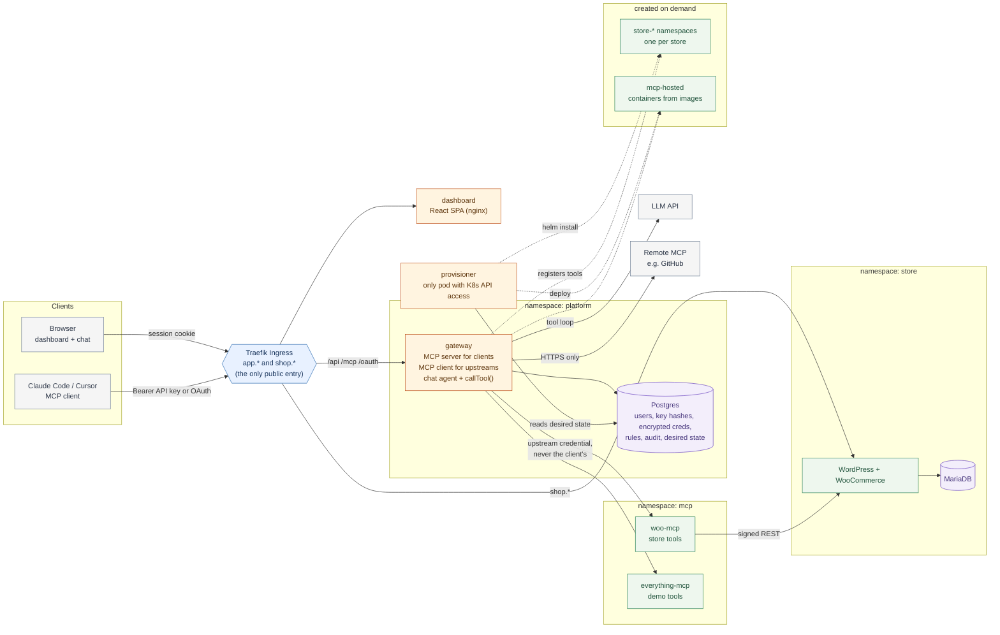

# Architecture

## Reading the diagram

- **Only the Ingress is public.** Every other box is reachable only through NetworkPolicies that allow specific callers: woo-mcp accepts the gateway only, MariaDB accepts WordPress only.
- **Every tool call goes through the gateway's `callTool()`**, from the browser chat and from external MCP clients. It checks permissions, applies the rate limit and timeout, calls the upstream and writes the audit row.
- **Upstream credentials are held by the gateway** (encrypted in Postgres). Clients never see them, and client tokens are never forwarded.
- **The gateway never talks to Kubernetes.** It writes desired state to Postgres, and the provisioner (the only component with cluster access) installs stores and hosted servers.
- Dotted lines are the on-demand paths (extra stores and hosted servers).
