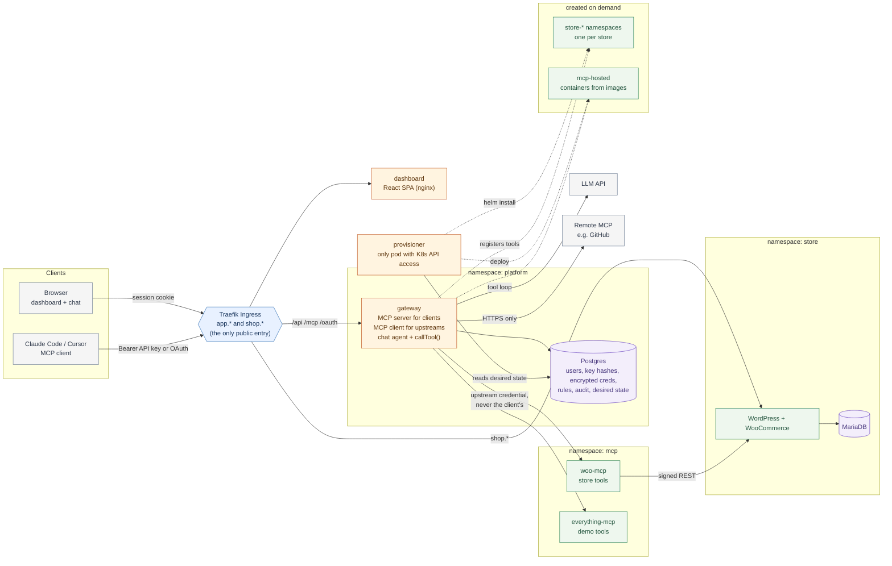

# System design and tradeoffs

## Architecture



- **Only the Ingress is public.** Every other box is reachable only through NetworkPolicies that allow specific callers: woo-mcp accepts the gateway only, MariaDB accepts WordPress only.
- **Every tool call goes through the gateway's `callTool()`**, from the browser chat and from external MCP clients. It checks permissions, applies the rate limit and timeout, calls the upstream and writes the audit row.
- **Upstream credentials are held by the gateway** (encrypted in Postgres). Clients never see them, and client tokens are never forwarded.
- **The gateway never talks to Kubernetes.** It writes desired state to Postgres, and the provisioner (the only component with cluster access) installs stores and hosted servers.
- Dotted lines are the on-demand paths (extra stores and hosted servers).

| Component | Responsibility | State |
|---|---|---|
| WordPress + WooCommerce | The store | MariaDB PVC + wp-content PVC |
| store-setup Job | Install and configure WooCommerce, create the REST key, seed products. Idempotent | none |
| woo-mcp | Our MCP server: 5 store tools over Streamable HTTP | none (stateless) |
| everything-mcp | Reference MCP server, in-cluster upstream for demos | none |
| gateway | MCP server to clients, MCP client to upstreams, dashboard API, chat agent | Postgres + in-memory upstream status |
| dashboard | React SPA | none |

Namespaces split the system by trust: `store` (customer data), `mcp` (tool servers), `platform` (identity and secrets). Each namespace is default-deny, with explicit allows.

## Tool aggregation

- The gateway keeps **one MCP client per enabled upstream**, created lazily and recreated after any transport error. That covers upstream restarts and expired upstream sessions.
- A **health poller** connects to and runs `tools/list` against every upstream every 5 s. The result is a cached catalog plus a status per server.
- `tools/list` on the gateway is served **from that cache**: tools of every enabled, connected upstream, filtered by the caller's role, renamed `<slug>__<tool>`, with descriptions prefixed by the server's name. A slow upstream can never make listing slow.

## Routing

`tools/call woo__list_orders` → split on the **first** `__` → upstream `woo`, tool `list_orders`. Slugs match `^[a-z0-9-]{1,16}$`, so they can't contain `_` and the split is unambiguous. Slugs are immutable because renaming one would rename every tool clients know.

All calls, from `/mcp` and from the chat agent, go through one function, `core/router.ts:callTool`. In order, it:

1. checks that the server exists, is enabled and is not unreachable,
2. checks that the tool exists and the role may use it,
3. calls the upstream with the decrypted credential injected as a header,
4. applies the timeout,
5. writes the audit row.

### Collision scheme

Every tool is always prefixed, even with no collision. Alternative: prefix only on collision. Rejected because adding a server would silently rename existing tools.

## Failure handling

| Situation | Behavior |
|---|---|
| Upstream dead (pod killed, DNS fails, connection refused) | Status goes Unreachable after 2 failed checks in a row (a new server: after 1). Its tools disappear from the list, and calls fail fast with the last error. Other upstreams are unaffected; checks run in parallel with `Promise.allSettled`. |
| Upstream slow | Each check is bounded at 3 s and each call at 15 s (configurable). A timeout returns an `isError` result saying which server timed out. The connection is kept, since slow doesn't mean broken. |
| Upstream comes back | Next check succeeds and the server is Connected again. No restart needed. |
| Tool error from upstream | Passed through unchanged (`isError: true`) and audited as `tool_error`. |
| Postgres down | Gateway readiness fails and the pod leaves the Service. Liveness never depends on dependencies. |
| WooCommerce down | woo-mcp stays Ready (its probes check only itself); its tools return clear errors. |

## Key decisions

| Decision | Chosen | Alternative | Why |
|---|---|---|---|
| Gateway MCP transport | Stateless Streamable HTTP (new server per POST, no session id) | Stateful sessions + `tools/list_changed` | Nothing to lose on restart, and scales to more replicas. Cost: clients re-list to see changes. |
| API key storage | SHA-256 of a 256-bit random key | bcrypt/argon2 | Random keys can't be brute-forced, and a deterministic hash allows an indexed lookup. Passwords (low entropy) use scrypt. |
| Revocation | Soft delete (`revoked_at`), checked on every request with no cache | Delete row | Immediate effect, and calls with a revoked key are still attributed to the owner (`auth_revoked`). |
| Upstream credentials | AES-256-GCM in Postgres, key in a K8s Secret | One K8s Secret per upstream | No Kubernetes API access or RBAC needed, and a DB dump alone reveals nothing. |
| Chat agent identity | In-process call to `callTool` with the session's principal | Agent mints a key and calls `/mcp` over HTTP | Same choke point, so same checks and audit, without token minting. The model never chooses who it acts as. |
| woo-mcp → store | WooCommerce REST v3, OAuth 1.0a signed | WP-CLI via `kubectl exec`, direct SQL | Versioned API that runs WooCommerce's own logic, with no Kubernetes privileges. OAuth1 because WooCommerce only allows Basic auth over HTTPS, and in-cluster traffic is plain HTTP. |
| Store setup | Helm post-install/upgrade Job running WP-CLI | Custom WordPress image | Uses official images only, and re-runs safely on every upgrade. |
| Charts | Three charts / releases, one per namespace | Umbrella chart | Independent upgrade and rollback per layer. |
| Secrets | Created out-of-band by a script; charts only reference them | Chart-generated secrets | Same flow locally and in prod; nothing secret in values or git. |
| Ingress | Traefik on kind and k3s | ingress-nginx (retired) | One ingress class in both environments. |
| LLM | Any OpenAI-compatible endpoint | Provider SDK | Changing provider is a values change. |

## Handling many tools

Ten servers can mean hundreds of tools, too many to hand a model at once. Two meta-tools solve it:

- `search_tools {query}` scores the caller's *permitted* tools by keyword (name matches count more than description matches) and returns names, descriptions and input schemas.
- `run_tool {name, arguments}` runs one through the same `callTool()` choke point, so routing, permissions, rate limits and the audit entry all apply to the real tool.

An MCP client opts in with `?tools=search` (or the `X-Urumi-Tool-Mode: search` header) and then sees just those two tools. The chat agent switches on its own when a user can see more than `toolSearchThreshold` tools (30 by default). Keyword scoring was chosen over embeddings: no model, no index to keep in sync, and the result is explainable.

## Observability and rate limits

- **`/metrics`** (Prometheus text): calls by server and outcome, a latency histogram per server, rate-limited count, and per-upstream up and tool-count gauges. It is per replica and not routed through the ingress.
- **Dashboard Metrics page:** calls, error rate, average and p95 latency per server over 24 hours, computed from the audit table, so it is cluster-wide whichever replica answers.
- **Why a call failed:** the audit row carries the error message, and an unreachable upstream shows its last connection error.
- **Rate limits:** fixed one-minute windows per API key (per user for chat), counted in Postgres with one atomic upsert. A fixed window allows a burst at a window boundary; a token bucket would be smoother but needs more state. Postgres was chosen so the limit holds across replicas.

## Scaling the gateway

`gateway.replicas: 2` works because nothing that matters lives in a pod:

- MCP is stateless (a new server per POST, no session id), so any replica can take any request and a restart loses nothing. This is the reason sessions were rejected in the first place.
- Dashboard sessions, OAuth tokens, rate-limit counters and the audit log are in Postgres.
- Upstream health is per pod: each replica runs its own poller (5 s), so each converges on its own view. The cost is duplicate health checks, and the dashboard may show a status one poll behind depending on which replica answers. The registry reloads on the same poll, so a server added through one replica appears on the others within seconds.
- Rolling updates keep every pod serving (`maxUnavailable: 0`), a PodDisruptionBudget keeps one up during node drains, and pods spread over nodes by preference.

## OAuth

The gateway is also an OAuth 2.1 authorization server (RFC 8414 metadata, RFC 9728 protected-resource metadata, RFC 7591 dynamic registration, authorization code + PKCE, refresh rotation). An unauthenticated `/mcp` call answers `401` with `WWW-Authenticate: Bearer resource_metadata=...`, which is how a client like Claude Code discovers the login. Both API keys and OAuth access tokens work on `/mcp`: a token that starts with `urumi_` is an API key, anything else is tried as an OAuth token. Both resolve to the same principal and go through the same `callTool()`.

## Provisioner: hosted servers and stores

```
 dashboard ─► gateway ──writes desired state──► Postgres ◄──reads── provisioner ──► Kubernetes API
                │                                 (stores,                │            + helm
                │◄── registry reload (5 s) ───── hosted_servers,          ▼
                └──────── tool calls ───────────► upstreams)     namespaces, Secrets, Deployments,
                                                                  NetworkPolicies, store Helm releases
```

- **Desired state in a table, reconciled by a controller loop** (every 5 s). A provisioner restart in the middle of an install just re-reads the table and continues. Every step is idempotent: Secrets are created once and never overwritten, `helm upgrade --install` converges, and a release left `pending` by a crash is cleared first. This is how "creating a store is safe to retry" and "restart mid-provisioning completes or fails cleanly" are met.
- **Each store is the same Helm chart** as the main store, in its own namespace, plus its own `woo-mcp` and a ResourceQuota and LimitRange. Its MCP server registers itself in the gateway when the install finishes, with the store's id as the slug, so its tools are `acme__list_orders` and the chat agent can compare stores.
- **Failure is explicit:** a store that does not finish in `provisionTimeoutMinutes` (15) or whose install fails becomes `failed` with the reason shown in the dashboard, and can be retried or deleted.
- **Delete** unregisters the tools first, then removes the Helm release and the namespace (which removes volumes and Secrets), and only then the row.
- **One active provisioner:** a Postgres advisory lock means a second replica idles and takes over if the first dies.
- **Why a separate component** and not code in the gateway: see the threat model. The gateway never gets Kubernetes API access.
- **Alternatives considered:** a Kubernetes operator with a CRD (the idiomatic answer, but more machinery and a second source of truth next to Postgres, which already holds the ownership, limits and tool registration); the gateway calling the Kubernetes API directly (rejected on privilege grounds).

## What changes for production

- **DNS:** `domain` in values. sslip.io needs no DNS setup; a real domain needs an A record for `shop.` and `app.`.
- **Ingress / TLS:** k3s's Traefik; `ingress.tls.enabled: true` plus a cert-manager ClusterIssuer (HTTP-01).
- **Storage class:** `local-path` on k3s (`standard` on kind). Both are node-local, so single node.
- **Secrets:** `scripts/create-secrets.sh prod`; back up `.secrets/prod.env`.
- **Images:** GHCR, multi-arch, pinned tags.

Full steps: [vps.md](vps.md). Upgrades and rollbacks: [operations.md](operations.md).

## Known limitations

- **Single gateway replica:** upstream status lives in memory. More replicas would each run their own poller, which works but duplicates checks. A shared cache would be needed for consistent status across replicas.
- **No `tools/list_changed`:** clients re-list after a server is disabled. Calling a removed tool by name is rejected anyway.
- **Many tools:** all permitted tools go to the model at once. Fine for three servers; ten would need tool search.
- **WordPress and MariaDB run their entrypoints as root** (official images). Our own containers are non-root with read-only root filesystems.
